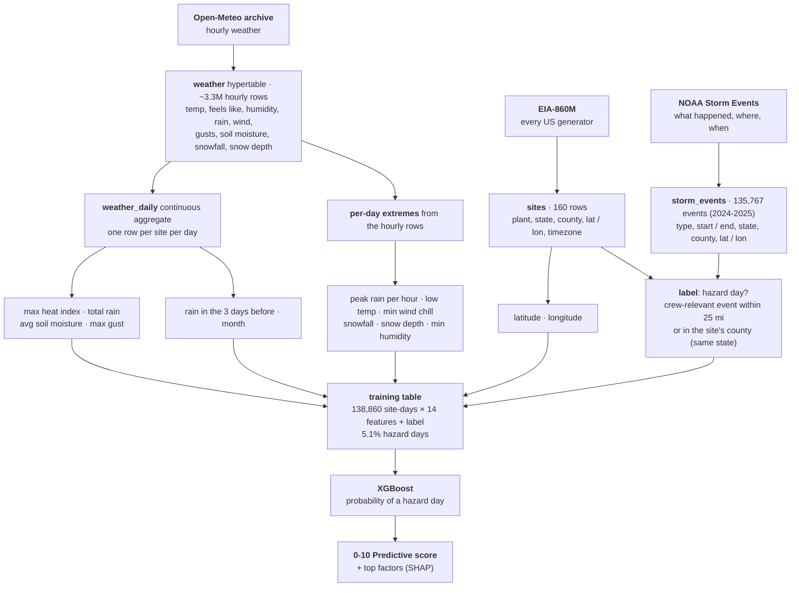
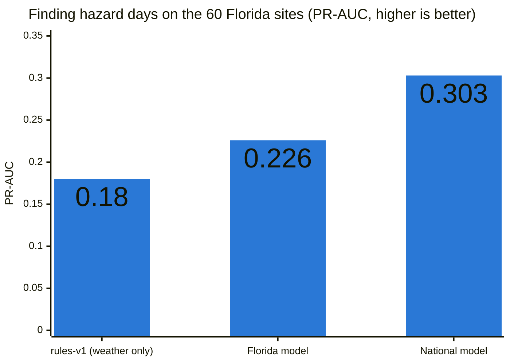
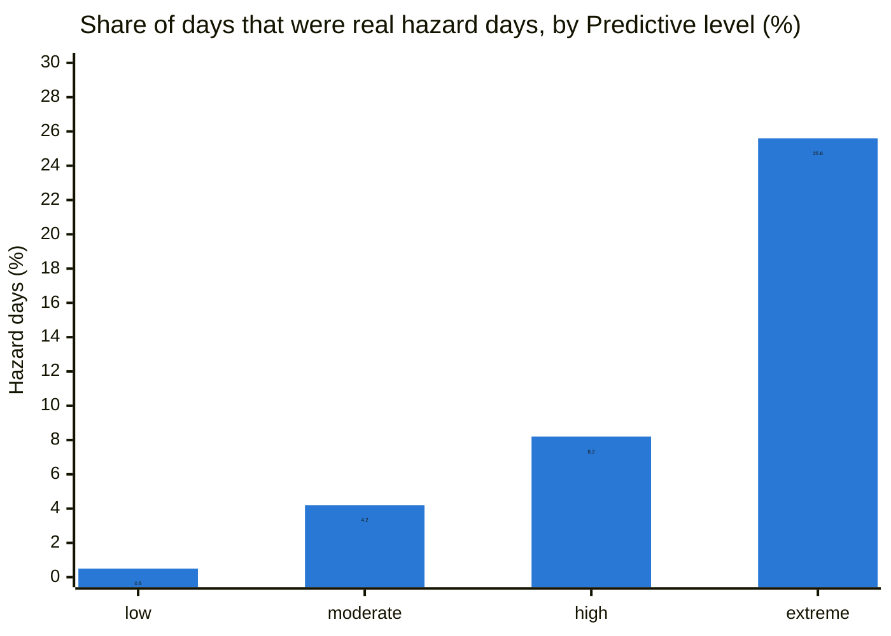

# Crew Care

> Which job sites are dangerous for field crews today, and tomorrow? A live 0-10 hazard score for 160 US power plants,
> one from work rules and one learned from weather history.

**SwampHacks · Sperry Tech challenge · Data: EIA-860M, NOAA Storm Events, NWS, Open-Meteo · Database: Tiger Data**

It's 6:45 AM in August at a job site in the Everglades. By noon the heat index will pass 110°F, thunderstorms are
building to the west, the access road is mud after a week of rain, and someone saw an alligator yesterday. Every one
of those hazards was knowable in advance, but the data is spread across a dozen agencies and apps, and the go/no-go
call gets made on instinct. Crew Care puts it on one map: for every site it pulls the conditions crews work in,
fires stop-work alerts, and scores the hazard level now and for the next 24 hours. We test whether a model trained on
weather history can (1) tell hazard days from normal ones on years it has never seen, (2) work in every region of the
country, and (3) catch what published work rules miss.

**Finding in one line:** weather history predicts crew-hazard days well (ROC-AUC 0.885 on unseen years), one national
model holds up in every region and is better at Florida than the Florida-only model, but the work rules still beat it on
wind and hurricanes and neither can see wildfire, so the dashboard shows both scores.

- **Model and its test numbers:** [`backend/planit/ml/models/xgb-2026-10-17-us.meta.json`](backend/planit/ml/models/xgb-2026-10-17-us.meta.json)
- **Test bench:** [`backend/planit/ml/evaluate.py`](backend/planit/ml/evaluate.py) prints every number in the Results section
- **Rules, with the source of every threshold:** [`backend/planit/hazards.py`](backend/planit/hazards.py)
- **Architecture, API contract, plan:** [`docs/ARCHITECTURE.md`](docs/ARCHITECTURE.md), [`docs/API.md`](docs/API.md), [`docs/WORKFLOW.md`](docs/WORKFLOW.md)

## Reproduce the model

From `backend/`, with `PLANIT_DATABASE_URL` in `.env`:

```bash
python scripts/load_sites.py --write                          # 160 plants from EIA-860M (file in data/raw/)
python scripts/load_storm_events.py                           # NOAA Storm Events files in data/raw/
python scripts/backfill_weather.py 2024-01-01 2025-12-31      # hourly weather history (~70 min, Open-Meteo free tier)
python -m planit.ml.train --version xgb-<date>                # train, test on 2025, save to planit/ml/models/
python -m planit.ml.evaluate                                  # leave-one-year-out test bench: every table below
python -m planit.ml.compare [--by-region]                     # model types / national vs per-region comparisons
```

The loaders print a dry run unless told to write. The backfill paces itself to Open-Meteo's free tier (10,000 calls a
day) and `--only-missing` fetches just the sites that have no history yet.

## Repository layout

```
├── README.md                     this file
├── dev.py                        every command: setup, api, web, worker, migrate, test, lint, ...
├── db/migrations/                schema: Postgres + TimescaleDB (hypertables, continuous aggregates) + PostGIS
├── backend/
│   ├── planit/
│   │   ├── hazards.py            rules-v2: every hazard on one 0-10 scale, from OSHA / NWS work rules
│   │   ├── models.py             API contract: every JSON shape
│   │   ├── ml/
│   │   │   ├── features.py       one row per site-day: weather features + NOAA hazard-day label
│   │   │   ├── train.py          XGBoost, trained on 2023-2024, tested on 2025, then refit on all
│   │   │   ├── model.py          probability -> 0-10 score, SHAP factors, OSHA heat floor
│   │   │   ├── evaluate.py       leave-one-year-out test bench, by region, hazard and level
│   │   │   ├── compare.py        model types on identical inputs; national vs one model per region
│   │   │   ├── score.py          writes both scores for every site, now + 24 h, every 5 min
│   │   │   └── models/           trained models + their test metrics
│   │   ├── worker/
│   │   │   ├── ingest/           Open-Meteo, NWS weather, NWS alerts (one national request)
│   │   │   └── rules/            lightning stop-work rule, flood rule
│   │   └── api/                  FastAPI routes (reads the database, never calls the worker)
│   ├── scripts/                  load_sites, load_storm_events, backfill_weather, migrate
│   └── tests/                    pytest: rules, features, model, ingest, API contract
├── frontend/                     Next.js 16: risk map, ranked sites, site page, alerts, crew reports
├── deploy/                       Vultr server: Caddy, systemd services, auto-deploy of main
├── docs/                         architecture, API contract, workflow, model and region comparisons
└── data/raw/                     downloaded EIA and NOAA files (NOT committed)
```

## Data

- **Sites:** 160 power plants from EIA-860M (August 2026): 60 hand-picked in Florida, plus 100 across the other 49
  states: one per state, the rest by each state's share of plants of 50 MW or more, largest first, at least 50 miles
  apart. Timezones by location, Arizona, Alaska and Hawaii included.
- **Weather history:** Open-Meteo archive, hourly: temperature, humidity, "feels like", rain, wind, gusts, soil
  moisture, snowfall, snow depth. Florida 2023-2025, the other sites 2024-2025, about 3.3M hourly rows, rolled up per
  day by a TimescaleDB continuous aggregate.
- **Labels:** NOAA Storm Events, 2024-2025 for every state plus Florida 2023 (135,767 events in 2024-2025). A site-day
  is a **hazard day** when a crew-relevant event (thunderstorm wind, hail, lightning, tornado, flood, heat, tropical,
  high wind, cold, winter storm, wildfire, dust storm) happened within 25 miles or in the site's county, matched on
  state and county.
- **138,860 site-days, 5.1% of them hazard days.**

How the tables stack up into the model's training table, one row per site per day:


- **Test design:** every number below is out of sample. In the test bench each year is scored by a model trained on the
  other years (2023, 2024, 2025). The saved model's own check trains on 2023-2024 and tests on 2025.

Live, the dashboard adds the NWS (forecast, station observations and warnings, every 30 min and 2 min) and Open-Meteo's
forecast (soil moisture, storm energy) to these.

## Results

| | Florida model, `xgb-2026-10-17` | **National model, `xgb-2026-10-17-us`** |
|---|---|---|
| Training data | 60 sites, 65,760 site-days | **160 sites, 138,860 site-days** |
| ROC-AUC (0.5 = guessing) | 0.854 | **0.885** |
| PR-AUC (guessing = the hazard rate) | 0.226 (guessing 0.03) | **0.328** (guessing 0.05) |
| ...on the same 60 Florida sites | 0.226 | **0.303** |
| When it said "high", a real hazard day | 16% | 20% (Florida sites: 18%) |
| Hazard days it flagged "high" or above | 54% | **76%** (Florida sites: 72%) |

The last two rows are at the dashboard's "high" level, on the national model's new scale: the same as the Real-time
score's (see [One scale for both scores](#one-scale-for-both-scores)). That scale catches more hazard days and accepts
more false alarms than the Florida model's did. ROC-AUC and PR-AUC rank days by probability, so the scale doesn't
change them.



| # | Question | Verdict |
|---|---|---|
| Q1 | Can daily weather tell hazard days from normal ones on years the model never saw? | **Supported.** ROC-AUC 0.885; PR-AUC 0.328 against 0.051 for guessing |
| Q2 | Does one national model hold up in every region, or does each need its own? | **One model.** ROC-AUC 0.871-0.905 in all five regions; region-only models don't beat it, except slightly in the West |
| Q3 | Does training on all 50 states help Florida? | **Supported.** Same 60 sites: PR-AUC 0.226 -> 0.303 |
| Q4 | Do the dashboard levels mean something, and the same on both scores? | **Supported.** Each Predictive level is as often a real hazard day as the same Real-time level (moderate 4.2% vs 4.3%, extreme 26% vs 21%); "low" 0.5% |
| Q5 | Do the OSHA / NWS work rules match the model? | **Partly.** Rules win on wind and hurricanes, the model on floods, winter and storms; so we show both |
| Q6 | Can weather alone see wildfire? | **Not supported.** 37% of fire and dust days flagged; the Hughes Fire was missed |

**These are not blind tests.** We chose the features, the hazard event types and the test cases after seeing the
Florida results, with all three years in view. The XGBoost settings were never tuned (one fixed set, in `train.py`).
The 2025 check of the saved model is the cleanest number (ROC-AUC 0.883, PR-AUC 0.313).

**Variants tested:** rules-v1, rules-v2 (on daily history), the Florida XGBoost model, the national model alone, the
national model with the OSHA heat floor (what the dashboard shows), and the four model types below.

### Why XGBoost

**Model comparison** (`python -m planit.ml.compare`, saved to [`docs/model_comparison.csv`](docs/model_comparison.csv)):
every model gets the same site-days, first with the 7 inputs the Florida model had, then with all 14. Each year is
scored by a model trained on the other years.

| Inputs | Model | ROC-AUC | PR-AUC | Brier (lower is better) | Riskiest 10% were hazard days | Fit time |
|---|---|---|---|---|---|---|
| 7 Florida features | logistic regression | 0.757 | 0.206 | 0.0448 | 19.9% | 1 s |
| 7 Florida features | random forest | 0.843 | 0.261 | 0.0426 | 23.2% | 27 s |
| 7 Florida features | gradient boosting (sklearn) | 0.845 | 0.257 | 0.0427 | 22.9% | 9 s |
| 7 Florida features | XGBoost | 0.847 | 0.259 | 0.0426 | 23.2% | 10 s |
| all 14 features | logistic regression | 0.805 | 0.232 | 0.0440 | 22.2% | 2 s |
| all 14 features | random forest | 0.878 | 0.319 | 0.0406 | 27.5% | 40 s |
| all 14 features | gradient boosting (sklearn) | 0.882 | 0.326 | 0.0402 | 28.4% | 16 s |
| all 14 features | **XGBoost** | **0.885** | **0.336** | **0.0399** | **28.7%** | 18 s |

- **The inputs matter more than the model.** Adding the national features (snowfall, wind chill, low temperature,
  dry air, location) lifts every model by about 0.04 ROC-AUC and 0.07 PR-AUC. Switching between the three tree models
  changes ROC-AUC by under 0.01.
- **A straight line isn't enough.** Logistic regression is far behind (0.805): hazards are thresholds and
  combinations, like heavy rain on saturated ground or wind chill only below freezing, which trees capture and a linear
  model can't.
- **XGBoost is best on every measure, narrowly.** We chose it for that and for three practical reasons:
  - It takes missing values as they are. Florida's history has no snow columns, and live inputs are sometimes missing.
  - It gives exact per-row SHAP contributions (`pred_contribs`). That's how every score shows its top factors, such
    as "Downpours up to 1.2 in/h · +3.1".
  - It trains in seconds and its probabilities are calibrated (Brier 0.0399, the lowest).

These are probabilities scored directly, so the XGBoost row is a little higher than the Results table, which scores
the 0-10 dashboard score (it tops out at 10).

### One scale for both scores

The Real-time score is hand-set against work rules; the model outputs a probability. To put them on one 0-10 scale,
we measured how often each Real-time score turned out to be a hazard day (every historical site-day, isotonic fit:
2.5 → 2.1%, 5 → 6.8%, 7.5 → 13%, 10 → 56%). A Predictive probability then scores as **the Real-time score with the
same odds**: a Predictive 5 is as likely to be a hazard day as a Real-time 5. The mapping is stored with the model
(`scale` in its `.meta.json`, `python -m planit.ml.scale`), so retraining refits it.



| Level | Real-time: real hazard days | Predictive: real hazard days | Predictive: share of all days |
|---|---|---|---|
| low (0-2.4) | 1.1% | 0.5% | 57% |
| moderate (2.5-4.9) | 4.3% | 4.2% | 20% |
| high (5-7.4) | 7.4% | 8.2% | 10% |
| extreme (7.5-10) | 21.4% | 25.6% | 12% |

Same odds per level, but Predictive picks out more high-odds days than the rules can, so it says "extreme" on 12% of
days against Real-time's 4%, mostly in summer. On top of the model, per hour:

- **NWS warning floor:** while a warning is in force, Predictive can't be below that warning's Real-time severity
  (Wind Advisory 4.5, Heat Advisory 5, Blizzard Warning 9, lightning or a Tornado Warning 10). Frost and freeze
  alerts stay low (1-1.5).
- **OSHA heat floor:** a heat index of 103°F or more keeps it at least 5, and 115°F or more at least 7.5.
- Both floors apply hour by hour, using each warning's end time and each hour's forecast heat, so the forecast goes
  back down when the warning ends or the heat breaks.

The rescale made the Predictive score more cautious: at "high or above" it catches 76% of hazard days (61% before),
and 1 flag in 5 is a real hazard day (1 in 4 before). The probabilities themselves are unchanged and still calibrated:
the riskiest tenth of days were predicted at 27% and turned out 29%.

### One national model, or one per region?

Each region is scored on its own held-out years twice: by the national model, and by a model trained only on that
region's sites (`python -m planit.ml.compare --by-region`, saved to
[`docs/region_comparison.csv`](docs/region_comparison.csv)).

| Region | Sites | Hazard days | National: ROC-AUC / PR-AUC | Region only: ROC-AUC / PR-AUC |
|---|---|---|---|---|
| Florida | 60 | 2,775 | **0.884 / 0.310** | 0.877 / 0.299 |
| Northeast | 11 | 398 | **0.905 / 0.344** | 0.888 / 0.321 |
| Midwest | 24 | 1,237 | 0.871 / 0.371 | 0.871 / 0.374 |
| South | 36 | 1,904 | 0.881 / 0.379 | 0.882 / 0.380 |
| West | 29 | 788 | 0.874 / 0.260 | **0.879 / 0.281** |

One model wins: it's better in Florida and the Northeast, even in the Midwest and South, and slightly behind only in the
West. Small regions lose the most on their own (the Northeast has 398 hazard days), so sharing data helps. The West,
where fire, dust and dry air matter most, is the one to re-check with more history.

### By hazard

| Hazard (NOAA event types) | Days | Predictive | Real-time data |
|---|---|---|---|
| Heat | 626 | **92%** | 63% |
| Tropical (hurricane, tropical storm, surge) | 349 | 93% | **96%** |
| Winter (winter storm, heavy snow, blizzard, ice) | 611 | **82%** | 54% |
| Flood (flash flood, flood, heavy rain) | 1,969 | **80%** | 46% |
| Wind (strong, high wind) | 317 | 80% | **92%** |
| Storm (thunderstorm wind, hail, lightning, tornado) | 3,550 | **77%** | 51% |
| Cold (cold, extreme cold / wind chill) | 177 | **66%** | 44% |
| Fire / dust (wildfire, dust storm) | 169 | **37%** | 32% |

In this test the rules only see daily weather history. Live, they also get NWS warnings, lightning and storm energy.

**What the model looks at** (share of XGBoost gain): rain per hour 32%, rain in 24 h 18%, snowfall 8%, heat index 6%,
wind chill 6%, gusts 6%, latitude 5%, month 4%, low temperature 4%, longitude 3%, 3-day rain, soil moisture, dry air
and snow depth 2% each. The national features (snowfall, wind chill, location) rank right after rain.

### Test cases

| Case | Expected | Predictive | Real-time |
|---|---|---|---|
| Hurricane Idalia, Suwannee River (2023-08-30) | high | 10.0 ✓ | 10.0 ✓ |
| Hurricane Helene, Crystal River (2024-09-26) | high | 10.0 ✓ | 10.0 ✓ |
| Hurricane Milton landfall, Tampa (2024-10-09) | high | 10.0 ✓ | 10.0 ✓ |
| Arctic outbreak, Coal Creek, ND (2024-01-14) | high | 9.3 ✓ | 5.3 ✓ |
| Gulf Coast snowstorm, New Orleans (2025-01-21) | high | 8.9 ✓ | 6.0 ✓ |
| Calm January day, Tampa (2024-01-15) | low | 1.0 ✓ | 0.5 ✓ |
| Mild spring day, Diablo Canyon, CA (2024-05-01) | low | 0.0 ✓ | 4.9 ✗ |
| Hughes Fire, Castaic, CA (2025-01-22) | high | 1.1 ✗ | 6.3 ✓ |

## The app

- **Dashboard:** a risk map of all 160 sites and a ranked list, with a **Real-time / Predictive** switch. Stop-work
  lightning sites are flagged on the map.
- **Site page:** current conditions, the next 48 hours, the score's top factors with a recommended action for each
  (for example "Ground aerial lifts and bucket trucks" above 28 mph gusts), active alerts and the score history.
- **Alerts:** every active warning, refreshed every 10 seconds.
- **Briefings:** at 6 PM in each site's time zone, tomorrow's work day (6 AM - 6 PM) in a few sentences: the risk,
  peak heat, storm hours, gusts, snow, smoke, warnings in force and the precautions to take.
- **Crew reports:** a phone form with live GPS and a draggable pin, to put a hazard (wildlife, flooding, downed line,
  ...) on the site map.
- **Your own sites:** a manager adds a job site by address or pin and picks its crew. Within about a minute it has
  live NWS weather, smoke, nearby alerts and both scores. The model is national (it knows latitude and longitude),
  so a new location needs no retraining.

**Live:** [crewcare.207-246-119-236.sslip.io](https://crewcare.207-246-119-236.sslip.io/). One Vultr server runs the site,
the API and the worker, and deploys `main` automatically (see [`deploy/README.md`](deploy/README.md)).

**Real-time** (`hazards.py`) scores what's happening now against published rules: OSHA's heat-index bands, lift wind
limits, the NWS wind chill chart (frostbite in 30 min at -18°F), Dense Fog Advisory visibility, rain rate, saturated
ground, snow (Winter Storm Warning criteria, about 6 in in 24 h or 1 in/h), ice (Ice Storm Warning criteria, ¼ in), and
about 50 NWS warning types (Tornado Warning 10, Blizzard Warning 9, Wind Advisory 4.5). Three hazards the weather
can't show come from their own sources: **smoke** (the PM2.5 air quality index, hourly with a 2-day forecast, on the
EPA categories and Cal/OSHA's wildfire smoke rule: N95s at AQI 151, respirators required above 500), **wildfires**
(every active fire NIFC lists, by miles to its estimated edge, less once it's 90% contained) and **earthquakes** (every
USGS quake, by the shaking it should cause at the site, from the Atkinson & Wald 2007 intensity equation USGS uses;
damage starts around intensity VI). A site's score is its worst hazard plus a little for other serious ones.
**Predictive** is the model above on the same 0-10 scale, with the NWS warning, lightning, wildfire, earthquake,
smoke and OSHA heat floors on top, hour by hour.

| Tool | What it does here |
|---|---|
| **Tiger Data (TimescaleDB + PostGIS)** | Hypertables for weather, NWS weather, lightning strikes and scores; a continuous aggregate (`time_bucket`, 1 day) for the model's daily features; `ST_DWithin` for strikes within 10 miles of a site |
| **NWS API** | Hourly forecast and station observations for the Real-time score (wind chill, WBGT, visibility, ice), and every active warning in one national request, matched to sites by polygon or zone |
| **Open-Meteo** | Hourly weather history for training; soil moisture, storm energy and the model's live inputs; air quality (PM2.5 AQI, CAMS model) for smoke |
| **NIFC (WFIGS)** | Every active US wildfire in one national request: location, acres, % contained |
| **USGS Earthquakes** | Every M2.5+ quake of the last day in one feed, scored by the shaking expected at each site |
| **NOAA Storm Events** | The labels: what actually happened, where and when |
| **EIA-860M** | Every US power plant, with coordinates, utility and type |
| **Vultr** | Hosts the live site: one Ubuntu server running the site, API and worker behind Caddy (HTTPS), auto-deploying `main` |
| **Auth0** | |
| **Gemini** | Writes each site's 6 PM next-day briefing from its facts (20 sites per call); a summary is kept only if every number in it is in the facts, otherwise the template is used |

## What's not done yet

- **On a branch, not merged:** the lightning stop-work rule with its 30-minute countdown, and a `simulate` script for
  demos (lightning, hurricane, flood, blizzard). Demo buttons in the app come later.
- **Not built:** crew reports raising the score, the
  river flood rule with NWS flood stages, satellite fire detections (NASA FIRMS, which see new fires sooner than
  NIFC's reports), fire perimeters, and debris flows.

## Limitations

- Two years of history outside Florida, three in Florida; one site per small state.
- NOAA offices log events more or less thoroughly, so labels are uneven; that's why the OSHA heat floor and the rules
  stay on top of the model.
- Predictive answers "how likely is a NOAA-recorded hazard day", so on a breezy day that's over lift limits but not
  severe it stays low while Real-time doesn't. Quiet regions and seasons sit near 0; that's the real odds, on the
  shared scale.
- The model itself can't see fires, smoke or earthquakes (Q6); the Real-time rules do, and Predictive gets them only
  through its floors. Fires are what agencies report to NIFC, so a new one can take hours to appear, and its edge is
  estimated from its size, not its perimeter. Smoke is modelled (CAMS), not read from monitors. Earthquake shaking is
  an estimate from magnitude and distance; it doesn't know the site's soil.

## Run it locally

Prerequisites: **Python 3.11+** (on Windows tick "Add python.exe to PATH"), **Node.js 22 LTS**, and **pnpm**
(`npm install -g pnpm`). Close and reopen the terminal afterwards. All commands go through `dev.py` and are the same on
every OS: **Windows `python`** (or `py`), **macOS `python3`**.

```
python dev.py setup     # installs everything, creates .env and frontend/.env.local
python dev.py api       # terminal 1: http://localhost:8000/docs
python dev.py web       # terminal 2: http://localhost:3000
```

Run `python dev.py` with no arguments to list every command (`worker`, `migrate`, `types`, `test`, `lint`, ...).
`.env` starts with `PLANIT_MOCK=1`, so the API serves sample data and the frontend works with no database. To use Tiger,
put the connection string in `PLANIT_DATABASE_URL` and set `PLANIT_MOCK=0`; `python dev.py migrate` applies new
migrations. Run `python dev.py test` and `python dev.py lint` before committing.

<details>
<summary>Windows troubleshooting</summary>

- **`python` opens the Microsoft Store or isn't found:** use `py dev.py setup`, or reinstall Python with "Add to PATH" ticked.
- **`pnpm` isn't recognized:** run `npm install -g pnpm`, then open a new terminal.
- **PowerShell says running scripts is disabled** (when calling pnpm): run
  `Set-ExecutionPolicy -Scope CurrentUser RemoteSigned` once, or use Command Prompt instead.

</details>

Who owns which folders, and the plan: [`docs/WORKFLOW.md`](docs/WORKFLOW.md).
